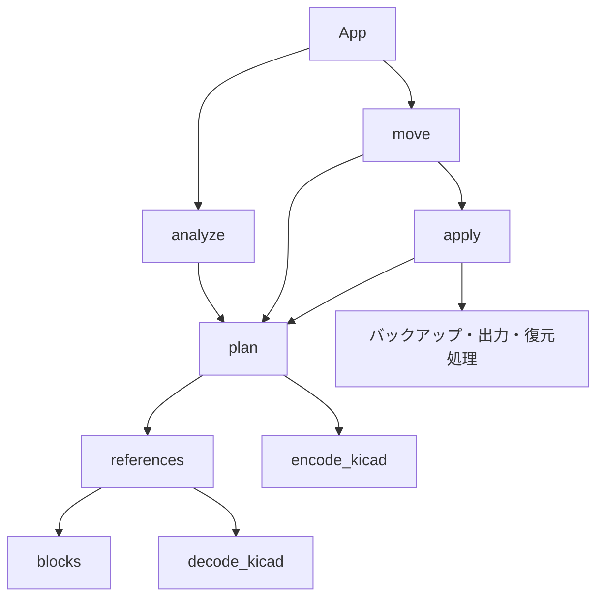

# KiCad Sheet Mover

## 目次

- [概要・動作仕様](#概要動作仕様)
- [動作環境と起動](#動作環境と起動)
- [使い方](#使い方)
- [安全対策と制限](#安全対策と制限)
- [バックアップと復元](#バックアップと復元)
- [内部構成](#内部構成)
- [テスト](#テスト)

## 概要・動作仕様

KiCadの階層シートを `sheet/` 直下へ集約する、Python / Tkinter製の独立GUIツールである。KiCad 10を対象としているが、実際のKiCad 10での読み込みは未確認である。

| 項目 | 動作 |
| --- | --- |
| 対象ファイル | 選択したルート回路図から `Sheetfile` で参照される全階層の `.kicad_sch` |
| プロジェクトの基準位置 | 選択したルート回路図の親フォルダー。`.kicad_pro` からは判定しない |
| 移動先 | 基準位置の `sheet/` 直下。元のフォルダー構造は維持しない |
| ルート回路図 | 元の位置に保持し、子シートへの参照パスを更新する |
| ファイル名 | 維持する。同名衝突時の自動変更は行わない |
| 参照パス | 移動後の親回路図を基準とした相対パスに更新する。区切りは `/` |
| 共有シート | 複数のシートから参照される同一ファイルを一度だけ処理する |
| 空フォルダー | 移動後も残す |
| その他のファイル | 参照されていない回路図、`.kicad_pro`、基板などは変更しない |

例：ルートから `Power.kicad_sch` と `Control/PLC.kicad_sch` を参照している場合。

```text
変更前                         変更後
MyProject/                     MyProject/
├─ MyProject.kicad_pro          ├─ MyProject.kicad_pro
├─ MyProject.kicad_sch          ├─ MyProject.kicad_sch
├─ Power.kicad_sch              ├─ sheet/
└─ Control/                    │  ├─ Power.kicad_sch
   └─ PLC.kicad_sch             │  └─ PLC.kicad_sch
                               ├─ Control/
                               └─ .sheet_mover_backup_<日時>/
```

## 動作環境と起動

- Python 3.10以上とTkinterを必要とする。
- Windows向けのツールである。GUIの実操作検証は未実施である。
- 外部Pythonパッケージのインストールやビルドは不要である。

ツールのフォルダーで実行する。ファイル名に空白があるため引用符で囲む。

```powershell
python "ki_sheet mover.py"
```

Tkinterの起動確認は次のコマンドで行える。

```powershell
python -m tkinter
```

終了するにはGUIのウィンドウを閉じる。設定ファイルや永続ログの出力機能はない。

## 使い方

1. 最初はプロジェクト全体のコピーを用意し、そのコピーで操作する。
2. KiCadで対象プロジェクトを閉じる。
3. ツールを起動し、`Browse...` でルートの `.kicad_sch` を選択する。パスの直接入力も可能である。
4. `Analyze` を押す。解析だけでは回路図を変更しない。
5. `Current path` と `New path` の一覧を確認する。ルート回路図は一覧に表示されない。
6. `Move sheets (with backup)` を押し、確認ダイアログで実行する。
7. 完了ダイアログのバックアップ保存先を確認する。
8. KiCadでプロジェクトを開き、全階層を開けることと参照先を確認する。

子シートがない場合、実行ボタンは有効にならない。既に `sheet/` にある子シートも一覧に含まれるため、一覧件数は実際に場所が変わるファイル数とは限らない。

## 安全対策と制限

次の条件を検出すると処理を中止する。

| 条件 | 対応 |
| --- | --- |
| 参照先が存在しない | 対象回路図と参照パスを確認する |
| 異なる子シートのファイル名が重複する | KiCad側で名前と参照を整理してから再解析する |
| 移動先に対象外の同名ファイルがある | 既存ファイルを確認して衝突を解消する |
| 循環参照がある | 階層構造を修正する |
| 基準位置の外側を参照している | プロジェクト内に参照を整理する |
| `Sheetfile` がない、空、または参照先が `.kicad_sch` 以外 | 階層シートの設定を確認する |
| `sheet` がシンボリックリンク、または解決先が基準位置の外側 | 通常のプロジェクト内フォルダーを使用する |
| プレビュー後に解析結果が変わった | `Analyze` をやり直す |

実行時にも再解析するが、ファイルをロックする機能はない。実行中はKiCadや他のツールで対象ファイルを編集しない。

読み込みはUTF-8（BOM付きも可）、出力はBOMなしUTF-8である。書き直しにより改行コードが変わる場合がある。KiCadのバージョン番号や回路図全体の構文を検証する機能はなく、KiCad自身による読み込み確認が必要である。環境変数を含む参照パスを展開する機能もない。

## バックアップと復元

変更前に、基準位置へ `.sheet_mover_backup_YYYYMMDD_HHMMSS_ffffff` を作成する。対象のルート・子回路図を、元の相対フォルダー構造でコピーする。プロジェクト全体のバックアップではない。

すべてのバックアップと一時ファイルの書き込みが済んでから、出力先を順次置き換え、移動元の子回路図を削除する。複数ファイル全体を一括で確定する仕組みではない。

処理中の例外発生時は元ファイルの復元と新規出力の削除を試みる。ただし、復元中のアクセス拒否やプロセスの強制終了などでは復元が完了しない可能性がある。

手動で戻す場合は次の手順を使用する。

1. KiCadとツールを閉じる。
2. 現在のプロジェクト全体を別の場所へ退避する。
3. 対象実行のバックアップ内のファイルを、相対パスを維持して基準位置へコピーし、対応する回路図を上書きする。
4. その実行で新たに作成された移動先ファイルだけを、実行前の構成と照合して削除する。`sheet/` 全体を一律に削除しない。
5. KiCadで元の階層構成を確認する。

エラーはダイアログで表示する。失敗時のバックアップは不完全な場合があるため、内容を確認してから利用する。

## 内部構成

```text
KiSheetMover/
├─ ki_sheet mover.py
├─ README.md
└─ test/
   └─ test_sheet_mover.py
```

| 要素 | 役割・入出力 |
| --- | --- |
| `blocks(text, keyword)` | 文字列内を除外し、対象S式ブロックの開始・終了位置を列挙する。不均衡を検出した場合は `ValueError` |
| `decode_kicad(s)` / `encode_kicad(s)` | パス文字列の引用符とバックスラッシュを変換する |
| `references(content)` | `sheet` 内の `Sheetfile` の文字列位置と参照パスを列挙する |
| `plan(root)` | `Path` を受け取り、`(root, base, dest, changed)` を返す。ファイルへの書き込みは行わない |
| `apply(p)` | 計画を再検証し、バックアップ・出力・移動元削除を行う。バックアップの `Path` を返す |
| `App(tk.Tk)` | パス選択、解析、一覧、確認、実行結果のダイアログを提供する |

`dest` は移動元から移動先への辞書、`changed` は移動元から更新後の回路図テキストへの辞書である。解析・実行時の例外はGUIで捕捉して表示する。



保守時に説明の補完対象となる、docstring未記載の関数は `decode_kicad`、`encode_kicad`、`references`、`plan`、`apply` と `App` の各メソッドである。

## テスト

プロジェクト直下で実行する。標準ライブラリの `unittest` を使用し、一時フォルダー内の簡易回路図で確認する。

```powershell
python -m unittest discover -s test -v
```

| テスト | 期待結果 |
| --- | --- |
| 複数階層・共有シート | 集約後の参照が正しく、元ファイルのバイト列がバックアップに残り、再解析できる |
| 循環参照 | `ValueError` で中止する |
| 参照先不明・同名衝突 | それぞれ `FileNotFoundError` / `ValueError` で中止する |
| 文字列中の `(sheet ...)` | 階層シートとして扱わない |
| 3回目のファイル置換で失敗 | 元ファイルを復元し、新規出力と一時ファイルを除去する |
| 解析後に内容を変更 | `RuntimeError` で実行を拒否する |

自動テスト6件の成功を確認している。これらはKiCadの実ファイル全般の互換性を保証するものではない。GUIの実操作、KiCad 10での読み込み、強制終了時の復旧は未確認である。
